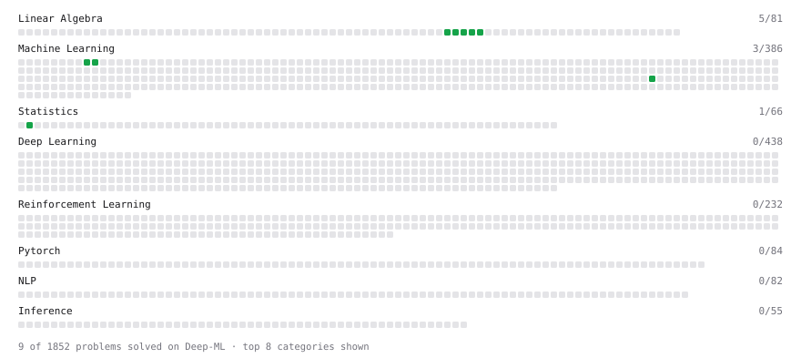

# Deep-ML

My machine learning practice from [Deep-ML](https://www.deep-ml.com). Every solution here was written by hand.

**30** solved · 27 problems · 0 labs · 3 math

[**Browse the interactive portfolio**](https://vaifai.github.io/deep-ml/) to replay this filling in over time.

## Problems

| | Difficulty | Solved | |
| --- | --- | --- | --- |
| [Batch Iterator for Dataset](https://www.deep-ml.com/problems/30) | easy | 2026-10-30 | [solution](problems/0030-batch-iterator-for-dataset) |
| [Descriptive Statistics Calculator](https://www.deep-ml.com/problems/78) | easy | 2026-10-30 | [solution](problems/0078-descriptive-statistics-calculator) |
| [Implement ReLU Activation Function](https://www.deep-ml.com/problems/42) | easy | 2026-11-02 | [solution](problems/0042-implement-relu-activation-function) |
| [Random Shuffle of Dataset](https://www.deep-ml.com/problems/29) | easy | 2026-10-30 | [solution](problems/0029-random-shuffle-of-dataset) |
| [Random Train/Validation/Test Split with Shuffling](https://www.deep-ml.com/problems/1058) | easy | 2026-10-30 | [solution](problems/1058-random-train-validation-test-split-with-shuffling) |
| [Single Neuron](https://www.deep-ml.com/problems/24) | easy | 2026-11-02 | [solution](problems/0024-single-neuron) |
| [Tensor Puzzle: Circular Roll by One](https://www.deep-ml.com/problems/1277) | easy | 2026-11-01 | [solution](problems/1277-tensor-puzzle-circular-roll-by-one) |
| [Tensor Puzzle: Extract the Diagonal](https://www.deep-ml.com/problems/1271) | easy | 2026-10-31 | [solution](problems/1271-tensor-puzzle-extract-the-diagonal) |
| [Tensor Puzzle: First-Order Difference](https://www.deep-ml.com/problems/1275) | easy | 2026-10-31 | [solution](problems/1275-tensor-puzzle-first-order-difference) |
| [Tensor Puzzle: Heaviside Step with Zero-Value](https://www.deep-ml.com/problems/1286) | easy | 2026-11-01 | [solution](problems/1286-tensor-puzzle-heaviside-step-with-zero-value) |
| [Tensor Puzzle: Identity Matrix from Comparisons](https://www.deep-ml.com/problems/1272) | easy | 2026-10-31 | [solution](problems/1272-tensor-puzzle-identity-matrix-from-comparisons) |
| [Tensor Puzzle: Linspace from Endpoints](https://www.deep-ml.com/problems/1285) | easy | 2026-11-01 | [solution](problems/1285-tensor-puzzle-linspace-from-endpoints) |
| [Tensor Puzzle: Ones Vector from First Principles](https://www.deep-ml.com/problems/1268) | easy | 2026-10-31 | [solution](problems/1268-tensor-puzzle-ones-vector-from-first-principles) |
| [Tensor Puzzle: Outer Product via Broadcasting](https://www.deep-ml.com/problems/1270) | easy | 2026-10-31 | [solution](problems/1270-tensor-puzzle-outer-product-via-broadcasting) |
| [Tensor Puzzle: Pad or Truncate a Vector to Length j](https://www.deep-ml.com/problems/1280) | easy | 2026-11-01 | [solution](problems/1280-tensor-puzzle-pad-or-truncate-a-vector-to-length-j) |
| [Tensor Puzzle: Repeat a Vector as Rows](https://www.deep-ml.com/problems/1287) | easy | 2026-11-01 | [solution](problems/1287-tensor-puzzle-repeat-a-vector-as-rows) |
| [Tensor Puzzle: Reverse a Vector](https://www.deep-ml.com/problems/1278) | easy | 2026-11-01 | [solution](problems/1278-tensor-puzzle-reverse-a-vector) |
| [Tensor Puzzle: Stack Two Vectors as Rows](https://www.deep-ml.com/problems/1276) | easy | 2026-10-31 | [solution](problems/1276-tensor-puzzle-stack-two-vectors-as-rows) |
| [Tensor Puzzle: Sum a Vector with a Dot Product](https://www.deep-ml.com/problems/1269) | easy | 2026-10-31 | [solution](problems/1269-tensor-puzzle-sum-a-vector-with-a-dot-product) |
| [Tensor Puzzle: Upper-Triangular Ones Matrix](https://www.deep-ml.com/problems/1273) | easy | 2026-10-31 | [solution](problems/1273-tensor-puzzle-upper-triangular-ones-matrix) |
| [Tensor Puzzle: Bincount by Scatter-Add](https://www.deep-ml.com/problems/1282) | medium | 2026-11-01 | [solution](problems/1282-tensor-puzzle-bincount-by-scatter-add) |
| [Tensor Puzzle: Compress — Keep True Positions](https://www.deep-ml.com/problems/1279) | medium | 2026-11-01 | [solution](problems/1279-tensor-puzzle-compress-keep-true-positions) |
| [Tensor Puzzle: Cumulative Sum via Triangular Matmul](https://www.deep-ml.com/problems/1274) | medium | 2026-10-31 | [solution](problems/1274-tensor-puzzle-cumulative-sum-via-triangular-matmul) |
| [Tensor Puzzle: Flatten a Matrix by Indexing](https://www.deep-ml.com/problems/1284) | medium | 2026-11-01 | [solution](problems/1284-tensor-puzzle-flatten-a-matrix-by-indexing) |
| [Tensor Puzzle: Scatter-Add into Bins](https://www.deep-ml.com/problems/1283) | medium | 2026-11-01 | [solution](problems/1283-tensor-puzzle-scatter-add-into-bins) |
| [Tensor Puzzle: Sequence Mask by Lengths](https://www.deep-ml.com/problems/1281) | medium | 2026-11-01 | [solution](problems/1281-tensor-puzzle-sequence-mask-by-lengths) |
| [Tensor Puzzle: Bucketize Values into Bins](https://www.deep-ml.com/problems/1288) | hard | 2026-11-01 | [solution](problems/1288-tensor-puzzle-bucketize-values-into-bins) |

## Math

| | Difficulty | Solved | |
| --- | --- | --- | --- |
| [Descriptive Statistics](https://www.deep-ml.com/math-problems/18) | easy | 2026-10-30 | [solution](math/0018-descriptive-statistics) |
| [ML Workflow Basics](https://www.deep-ml.com/math-problems/30) | easy | 2026-10-30 | [solution](math/0030-ml-workflow-basics) |
| [What the Bias Term Buys: Affine Maps, the Bias Gradient and When It Is Redundant](https://www.deep-ml.com/math-problems/277) | easy | 2026-11-02 | [solution](math/0277-what-the-bias-term-buys-affine-maps-the-bias-gradient-and-when-it-is-redundant) |

---

_This file is regenerated by Deep-ML on every push._
