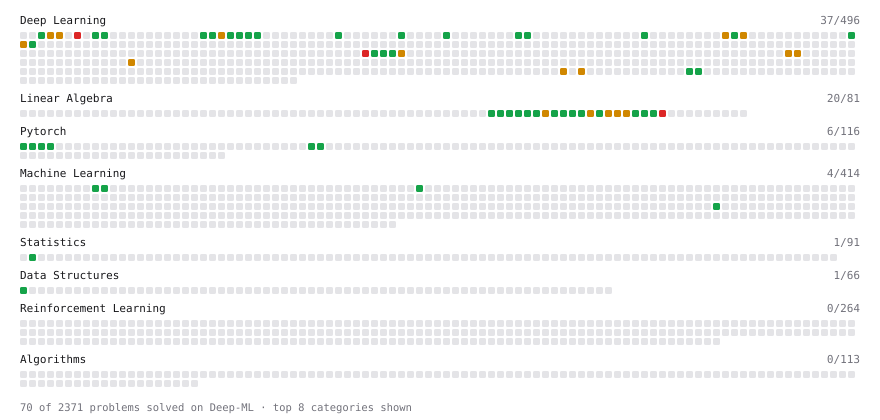

# Deep-ML

My machine learning practice from [Deep-ML](https://www.deep-ml.com). Every solution here was written by hand.

**101** solved · 85 problems · 6 labs · 10 math

[**Browse the interactive portfolio**](https://vaifai.github.io/deep-ml/) to replay this filling in over time.

## Problems

| | Difficulty | Solved | |
| --- | --- | --- | --- |
| [Activation Health Check: Saturated and Dead tanh Units](https://www.deep-ml.com/problems/1996) | easy | 2026-11-12 | [solution](problems/1996-activation-health-check-saturated-and-dead-tanh-units) |
| [Add a Bias Vector to a Batch via Broadcasting](https://www.deep-ml.com/problems/882) | easy | 2026-11-20 | [solution](problems/0882-add-a-bias-vector-to-a-batch-via-broadcasting) |
| [Backprop a Linear Layer by Hand](https://www.deep-ml.com/problems/898) | easy | 2026-11-21 | [solution](problems/0898-backprop-a-linear-layer-by-hand) |
| [Backward Pass of Tanh Using Cached Output](https://www.deep-ml.com/problems/999) | easy | 2026-11-06 | [solution](problems/0999-backward-pass-of-tanh-using-cached-output) |
| [Backward Pass of Tensor Reshape](https://www.deep-ml.com/problems/1000) | easy | 2026-11-06 | [solution](problems/1000-backward-pass-of-tensor-reshape) |
| [Batch a TensorDataset with DataLoader](https://www.deep-ml.com/problems/1237) | easy | 2026-11-21 | [solution](problems/1237-batch-a-tensordataset-with-dataloader) |
| [Batch Iterator for Dataset](https://www.deep-ml.com/problems/30) | easy | 2026-10-30 | [solution](problems/0030-batch-iterator-for-dataset) |
| [Build a Dataset and Use It with a DataLoader](https://www.deep-ml.com/problems/899) | easy | 2026-11-21 | [solution](problems/0899-build-a-dataset-and-use-it-with-a-dataloader) |
| [Build a Linear Regression Model with nn.Module](https://www.deep-ml.com/problems/885) | easy | 2026-11-21 | [solution](problems/0885-build-a-linear-regression-model-with-nn-module) |
| [Build an MLP with nn.Sequential](https://www.deep-ml.com/problems/887) | easy | 2026-11-21 | [solution](problems/0887-build-an-mlp-with-nn-sequential) |
| [Calculate Number of Parameters in Neural Network](https://www.deep-ml.com/problems/371) | easy | 2026-11-12 | [solution](problems/0371-calculate-number-of-parameters-in-neural-network) |
| [Compute a Gradient with PyTorch Autograd](https://www.deep-ml.com/problems/884) | easy | 2026-11-20 | [solution](problems/0884-compute-a-gradient-with-pytorch-autograd) |
| [Create a Float Tensor from a Python List](https://www.deep-ml.com/problems/880) | easy | 2026-11-20 | [solution](problems/0880-create-a-float-tensor-from-a-python-list) |
| [Create and Inspect a Tensor](https://www.deep-ml.com/problems/1220) | easy | 2026-11-20 | [solution](problems/1220-create-and-inspect-a-tensor) |
| [Derivatives of Activation Functions](https://www.deep-ml.com/problems/217) | easy | 2026-11-02 | [solution](problems/0217-derivatives-of-activation-functions) |
| [Descriptive Statistics Calculator](https://www.deep-ml.com/problems/78) | easy | 2026-10-30 | [solution](problems/0078-descriptive-statistics-calculator) |
| [Dynamic Tanh: Normalization-Free Transformer Activation](https://www.deep-ml.com/problems/128) | easy | 2026-11-02 | [solution](problems/0128-dynamic-tanh-normalization-free-transformer-activation) |
| [GeLU Activation Function ](https://www.deep-ml.com/problems/147) | easy | 2026-11-02 | [solution](problems/0147-gelu-activation-function) |
| [Gradient of a Square with Autograd](https://www.deep-ml.com/problems/1222) | easy | 2026-11-20 | [solution](problems/1222-gradient-of-a-square-with-autograd) |
| [Implement a Linear Layer Forward Pass with Matrix Multiplication](https://www.deep-ml.com/problems/883) | easy | 2026-11-20 | [solution](problems/0883-implement-a-linear-layer-forward-pass-with-matrix-multiplication) |
| [Implement He Weight Initialization](https://www.deep-ml.com/problems/290) | easy | 2026-11-10 | [solution](problems/0290-implement-he-weight-initialization) |
| [Implement ReLU Activation Function](https://www.deep-ml.com/problems/42) | easy | 2026-11-02 | [solution](problems/0042-implement-relu-activation-function) |
| [Implement SwiGLU activation function](https://www.deep-ml.com/problems/156) | easy | 2026-11-02 | [solution](problems/0156-implement-swiglu-activation-function) |
| [Implement the ELU Activation Function](https://www.deep-ml.com/problems/97) | easy | 2026-11-02 | [solution](problems/0097-implement-the-elu-activation-function) |
| [Implement the Hard Sigmoid Activation Function](https://www.deep-ml.com/problems/96) | easy | 2026-11-02 | [solution](problems/0096-implement-the-hard-sigmoid-activation-function) |
| [Implement the Mish Activation Function](https://www.deep-ml.com/problems/262) | easy | 2026-11-02 | [solution](problems/0262-implement-the-mish-activation-function) |
| [Implement the SELU Activation Function](https://www.deep-ml.com/problems/103) | easy | 2026-11-02 | [solution](problems/0103-implement-the-selu-activation-function) |
| [Implement the Softplus Activation Function](https://www.deep-ml.com/problems/99) | easy | 2026-11-02 | [solution](problems/0099-implement-the-softplus-activation-function) |
| [Implement the Softsign Activation Function](https://www.deep-ml.com/problems/100) | easy | 2026-11-02 | [solution](problems/0100-implement-the-softsign-activation-function) |
| [Implement the Swish Activation Function](https://www.deep-ml.com/problems/102) | easy | 2026-11-02 | [solution](problems/0102-implement-the-swish-activation-function) |
| [Implement Xavier/Glorot Weight Initialization](https://www.deep-ml.com/problems/369) | easy | 2026-11-10 | [solution](problems/0369-implement-xavier-glorot-weight-initialization) |
| [Leaky ReLU Activation Function](https://www.deep-ml.com/problems/44) | easy | 2026-11-02 | [solution](problems/0044-leaky-relu-activation-function) |
| [Min-Max Scaling of Feature Values](https://www.deep-ml.com/problems/112) | easy | 2026-11-18 | [solution](problems/0112-min-max-scaling-of-feature-values) |
| [Random Shuffle of Dataset](https://www.deep-ml.com/problems/29) | easy | 2026-10-30 | [solution](problems/0029-random-shuffle-of-dataset) |
| [Random Train/Validation/Test Split with Shuffling](https://www.deep-ml.com/problems/1058) | easy | 2026-10-30 | [solution](problems/1058-random-train-validation-test-split-with-shuffling) |
| [Reduce Gradient Across Broadcasted Dimensions](https://www.deep-ml.com/problems/998) | easy | 2026-11-06 | [solution](problems/0998-reduce-gradient-across-broadcasted-dimensions) |
| [Reshape and Transpose a Tensor](https://www.deep-ml.com/problems/1221) | easy | 2026-11-20 | [solution](problems/1221-reshape-and-transpose-a-tensor) |
| [Reshape and Transpose a Tensor](https://www.deep-ml.com/problems/881) | easy | 2026-11-20 | [solution](problems/0881-reshape-and-transpose-a-tensor) |
| [Run One Training Step: Forward, Loss, Backward, Optimizer](https://www.deep-ml.com/problems/886) | easy | 2026-11-21 | [solution](problems/0886-run-one-training-step-forward-loss-backward-optimizer) |
| [Save and Load Model Weights with state_dict](https://www.deep-ml.com/problems/888) | easy | 2026-11-23 | [solution](problems/0888-save-and-load-model-weights-with-state-dict) |
| [Shift and Scale Array to Target Range](https://www.deep-ml.com/problems/141) | easy | 2026-11-18 | [solution](problems/0141-shift-and-scale-array-to-target-range) |
| [Single Linear Neuron Forward](https://www.deep-ml.com/problems/1224) | easy | 2026-11-21 | [solution](problems/1224-single-linear-neuron-forward) |
| [Single Neuron](https://www.deep-ml.com/problems/24) | easy | 2026-11-02 | [solution](problems/0024-single-neuron) |
| [Tensor Puzzle: Circular Roll by One](https://www.deep-ml.com/problems/1277) | easy | 2026-11-01 | [solution](problems/1277-tensor-puzzle-circular-roll-by-one) |
| [Tensor Puzzle: Extract the Diagonal](https://www.deep-ml.com/problems/1271) | easy | 2026-10-31 | [solution](problems/1271-tensor-puzzle-extract-the-diagonal) |
| [Tensor Puzzle: First-Order Difference](https://www.deep-ml.com/problems/1275) | easy | 2026-10-31 | [solution](problems/1275-tensor-puzzle-first-order-difference) |
| [Tensor Puzzle: Heaviside Step with Zero-Value](https://www.deep-ml.com/problems/1286) | easy | 2026-11-01 | [solution](problems/1286-tensor-puzzle-heaviside-step-with-zero-value) |
| [Tensor Puzzle: Identity Matrix from Comparisons](https://www.deep-ml.com/problems/1272) | easy | 2026-10-31 | [solution](problems/1272-tensor-puzzle-identity-matrix-from-comparisons) |
| [Tensor Puzzle: Linspace from Endpoints](https://www.deep-ml.com/problems/1285) | easy | 2026-11-01 | [solution](problems/1285-tensor-puzzle-linspace-from-endpoints) |
| [Tensor Puzzle: Ones Vector from First Principles](https://www.deep-ml.com/problems/1268) | easy | 2026-10-31 | [solution](problems/1268-tensor-puzzle-ones-vector-from-first-principles) |
| [Tensor Puzzle: Outer Product via Broadcasting](https://www.deep-ml.com/problems/1270) | easy | 2026-10-31 | [solution](problems/1270-tensor-puzzle-outer-product-via-broadcasting) |
| [Tensor Puzzle: Pad or Truncate a Vector to Length j](https://www.deep-ml.com/problems/1280) | easy | 2026-11-01 | [solution](problems/1280-tensor-puzzle-pad-or-truncate-a-vector-to-length-j) |
| [Tensor Puzzle: Repeat a Vector as Rows](https://www.deep-ml.com/problems/1287) | easy | 2026-11-01 | [solution](problems/1287-tensor-puzzle-repeat-a-vector-as-rows) |
| [Tensor Puzzle: Reverse a Vector](https://www.deep-ml.com/problems/1278) | easy | 2026-11-01 | [solution](problems/1278-tensor-puzzle-reverse-a-vector) |
| [Tensor Puzzle: Stack Two Vectors as Rows](https://www.deep-ml.com/problems/1276) | easy | 2026-10-31 | [solution](problems/1276-tensor-puzzle-stack-two-vectors-as-rows) |
| [Tensor Puzzle: Sum a Vector with a Dot Product](https://www.deep-ml.com/problems/1269) | easy | 2026-10-31 | [solution](problems/1269-tensor-puzzle-sum-a-vector-with-a-dot-product) |
| [Tensor Puzzle: Upper-Triangular Ones Matrix](https://www.deep-ml.com/problems/1273) | easy | 2026-10-31 | [solution](problems/1273-tensor-puzzle-upper-triangular-ones-matrix) |
| [Thanksgiving Feast Predictor: Softmax for Dish Selection](https://www.deep-ml.com/problems/216) | easy | 2026-11-02 | [solution](problems/0216-thanksgiving-feast-predictor-softmax-for-dish-selection) |
| [Update-to-Data Ratio: Which Layers Train Too Fast?](https://www.deep-ml.com/problems/1997) | easy | 2026-11-13 | [solution](problems/1997-update-to-data-ratio-which-layers-train-too-fast) |
| [Backpropagation Gradients for a Dense Layer](https://www.deep-ml.com/problems/1076) | medium | 2026-11-05 | [solution](problems/1076-backpropagation-gradients-for-a-dense-layer) |
| [Backpropagation Through a Scalar Chain Network](https://www.deep-ml.com/problems/1075) | medium | 2026-11-05 | [solution](problems/1075-backpropagation-through-a-scalar-chain-network) |
| [Backward Pass of Row-wise Max Operation](https://www.deep-ml.com/problems/1001) | medium | 2026-11-07 | [solution](problems/1001-backward-pass-of-row-wise-max-operation) |
| [Calculate Number of Parameters in Neural Network](https://www.deep-ml.com/problems/291) | medium | 2026-11-12 | [solution](problems/0291-calculate-number-of-parameters-in-neural-network) |
| [Custom Autograd Function: Swish Forward and Backward](https://www.deep-ml.com/problems/1399) | medium | 2026-11-25 | [solution](problems/1399-custom-autograd-function-swish-forward-and-backward) |
| [Gradient of a Weighted Sum of Squares](https://www.deep-ml.com/problems/1223) | medium | 2026-11-20 | [solution](problems/1223-gradient-of-a-weighted-sum-of-squares) |
| [Implement a Custom `autograd.Function`](https://www.deep-ml.com/problems/903) | medium | 2026-11-25 | [solution](problems/0903-implement-a-custom-autograd-function) |
| [Implement He Weight Initialization for Neural Networks](https://www.deep-ml.com/problems/370) | medium | 2026-11-10 | [solution](problems/0370-implement-he-weight-initialization-for-neural-networks) |
| [Implement PReLU Forward and Backward Pass](https://www.deep-ml.com/problems/98) | medium | 2026-11-02 | [solution](problems/0098-implement-prelu-forward-and-backward-pass) |
| [Implement Xavier/Glorot Weight Initialization](https://www.deep-ml.com/problems/289) | medium | 2026-11-10 | [solution](problems/0289-implement-xavier-glorot-weight-initialization) |
| [Implementing Basic Autograd Operations](https://www.deep-ml.com/problems/26) | medium | 2026-11-05 | [solution](problems/0026-implementing-basic-autograd-operations) |
| [Jacobian Matrix Calculation](https://www.deep-ml.com/problems/202) | medium | 2026-11-04 | [solution](problems/0202-jacobian-matrix-calculation) |
| [Jacobians by Forward Mode and by Reverse Mode](https://www.deep-ml.com/problems/1835) | medium | 2026-11-04 | [solution](problems/1835-jacobians-by-forward-mode-and-by-reverse-mode) |
| [LSUV: Orthonormal Init plus Layer-Sequential Unit Variance](https://www.deep-ml.com/problems/1837) | medium | 2026-11-12 | [solution](problems/1837-lsuv-orthonormal-init-plus-layer-sequential-unit-variance) |
| [One Training Step](https://www.deep-ml.com/problems/1219) | medium | 2026-11-21 | [solution](problems/1219-one-training-step) |
| [Single Neuron with Backpropagation](https://www.deep-ml.com/problems/25) | medium | 2026-11-04 | [solution](problems/0025-single-neuron-with-backpropagation) |
| [Tensor Puzzle: Bincount by Scatter-Add](https://www.deep-ml.com/problems/1282) | medium | 2026-11-01 | [solution](problems/1282-tensor-puzzle-bincount-by-scatter-add) |
| [Tensor Puzzle: Compress — Keep True Positions](https://www.deep-ml.com/problems/1279) | medium | 2026-11-01 | [solution](problems/1279-tensor-puzzle-compress-keep-true-positions) |
| [Tensor Puzzle: Cumulative Sum via Triangular Matmul](https://www.deep-ml.com/problems/1274) | medium | 2026-10-31 | [solution](problems/1274-tensor-puzzle-cumulative-sum-via-triangular-matmul) |
| [Tensor Puzzle: Flatten a Matrix by Indexing](https://www.deep-ml.com/problems/1284) | medium | 2026-11-01 | [solution](problems/1284-tensor-puzzle-flatten-a-matrix-by-indexing) |
| [Tensor Puzzle: Scatter-Add into Bins](https://www.deep-ml.com/problems/1283) | medium | 2026-11-01 | [solution](problems/1283-tensor-puzzle-scatter-add-into-bins) |
| [Tensor Puzzle: Sequence Mask by Lengths](https://www.deep-ml.com/problems/1281) | medium | 2026-11-01 | [solution](problems/1281-tensor-puzzle-sequence-mask-by-lengths) |
| [Two-Layer MLP Forward Pass](https://www.deep-ml.com/problems/1225) | medium | 2026-11-21 | [solution](problems/1225-two-layer-mlp-forward-pass) |
| [Implementing a Custom Dense Layer in Python](https://www.deep-ml.com/problems/40) | hard | 2026-11-05 | [solution](problems/0040-implementing-a-custom-dense-layer-in-python) |
| [Manual Backprop Through Cross-Entropy Intermediates](https://www.deep-ml.com/problems/997) | hard | 2026-11-06 | [solution](problems/0997-manual-backprop-through-cross-entropy-intermediates) |
| [Tensor Puzzle: Bucketize Values into Bins](https://www.deep-ml.com/problems/1288) | hard | 2026-11-01 | [solution](problems/1288-tensor-puzzle-bucketize-values-into-bins) |

## Labs

| | Difficulty | Solved | |
| --- | --- | --- | --- |
| [Design Your Own Activation Function](https://www.deep-ml.com/labs/9) | easy | 2026-11-14 | [solution](labs/0009-design-your-own-activation-function) |
| [PyTorch: Build a Complete Training Loop](https://www.deep-ml.com/labs/13) | easy | 2026-11-27 | [solution](labs/0013-pytorch-build-a-complete-training-loop) |
| [MNIST: Pytorch DataLoader](https://www.deep-ml.com/labs/1) | medium | 2026-11-26 | [solution](labs/0001-mnist-pytorch-dataloader) |
| [PyTorch: Implement Your Own Gradient Descent Training Step](https://www.deep-ml.com/labs/12) | medium | 2026-11-27 | [solution](labs/0012-pytorch-implement-your-own-gradient-descent-training-step) |
| [MNIST: Build Neural Network from Scratch (NumPy Only)](https://www.deep-ml.com/labs/6) | hard | 2026-11-08 | [solution](labs/0006-mnist-build-neural-network-from-scratch-numpy-only) |
| [MNIST: Classification Loss (with Gradient)](https://www.deep-ml.com/labs/4) | hard | 2026-11-14 | [solution](labs/0004-mnist-classification-loss-with-gradient) |

## Math

| | Difficulty | Solved | |
| --- | --- | --- | --- |
| [Descriptive Statistics](https://www.deep-ml.com/math-problems/18) | easy | 2026-10-30 | [solution](math/0018-descriptive-statistics) |
| [ML Workflow Basics](https://www.deep-ml.com/math-problems/30) | easy | 2026-10-30 | [solution](math/0030-ml-workflow-basics) |
| [What the Bias Term Buys: Affine Maps, the Bias Gradient and When It Is Redundant](https://www.deep-ml.com/math-problems/277) | easy | 2026-11-02 | [solution](math/0277-what-the-bias-term-buys-affine-maps-the-bias-gradient-and-when-it-is-redundant) |
| [Backprop for a One-Hidden-Layer ReLU Softmax MLP in Matrix Form](https://www.deep-ml.com/math-problems/471) | medium | 2026-11-03 | [solution](math/0471-backprop-for-a-one-hidden-layer-relu-softmax-mlp-in-matrix-form) |
| [Backpropagation and the Chain Rule](https://www.deep-ml.com/math-problems/4) | medium | 2026-11-02 | [solution](math/0004-backpropagation-and-the-chain-rule) |
| [Forward Mode versus Reverse Mode: What a Jacobian Costs](https://www.deep-ml.com/math-problems/470) | medium | 2026-11-04 | [solution](math/0470-forward-mode-versus-reverse-mode-what-a-jacobian-costs) |
| [Matrix Calculus Identities](https://www.deep-ml.com/math-problems/35) | medium | 2026-11-03 | [solution](math/0035-matrix-calculus-identities) |
| [Neural Network Derivatives](https://www.deep-ml.com/math-problems/3) | medium | 2026-11-02 | [solution](math/0003-neural-network-derivatives) |
| [Perceptron Convergence Bound](https://www.deep-ml.com/math-problems/129) | medium | 2026-11-10 | [solution](math/0129-perceptron-convergence-bound) |
| [Variance Preservation and He/Glorot Scaling](https://www.deep-ml.com/math-problems/131) | medium | 2026-11-09 | [solution](math/0131-variance-preservation-and-he-glorot-scaling) |

---

_This file is regenerated by Deep-ML on every push._
